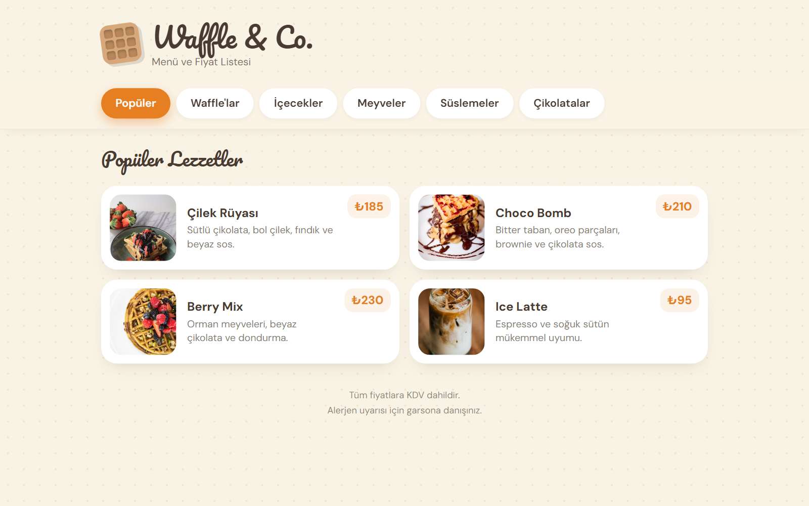

# Dijital QR Menü

> İnteraktif Dijital Menü

Kafe ve restoranlar için modern, hızlı ve kullanıcı dostu interaktif QR menü. Müşteriler masadaki QR kodu okutarak menüye ulaşır.

**Canlı demo:** https://serkangudur.com/projeler/dijital-qr-menu



## Öne çıkanlar

- Kategori filtresi ve kayan aktif gösterge
- Sağa/sola kaydırarak kategori değiştirme
- Animasyonlu ürün kartları
- Mobil öncelikli tasarım

## Teknolojiler

`HTML5` · `CSS3` · `JavaScript` · `GSAP`

## Yerelde çalıştırma

Derleme adımı yoktur; herhangi bir statik sunucu yeterlidir:

```bash
npx serve .
```

---

Bu proje [serkangudur.com](https://serkangudur.com) portfolyosunun bir parçasıdır. Sayfadaki iletişim bilgileri örnek amaçlıdır.
